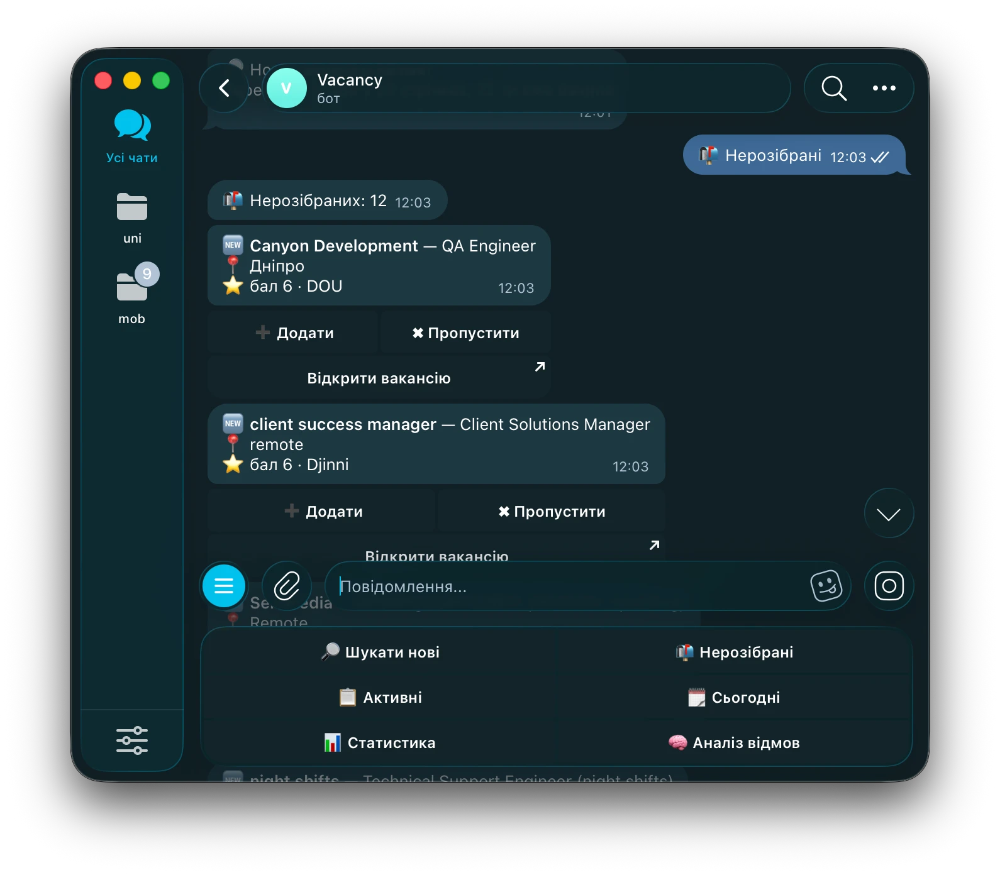
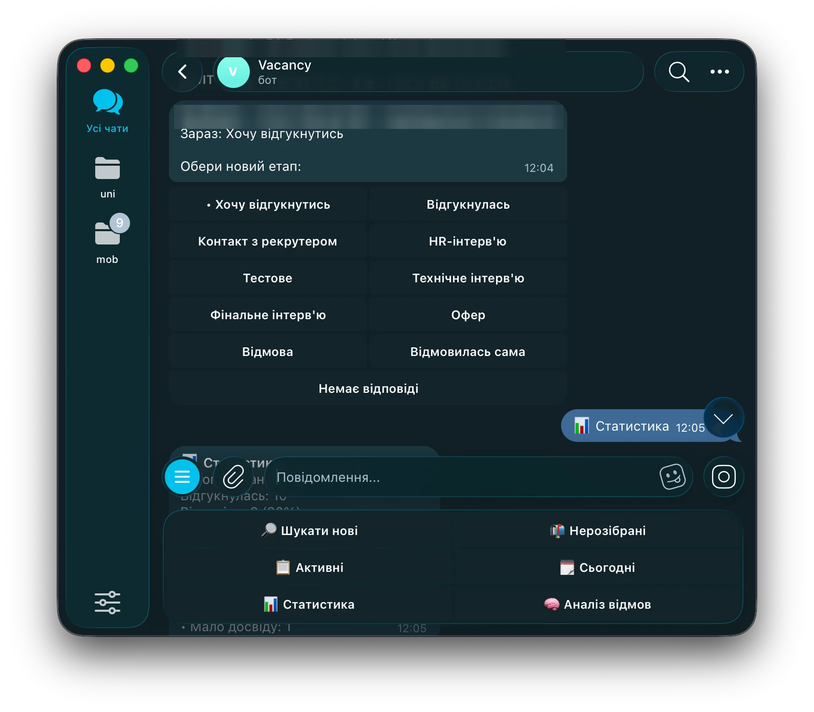
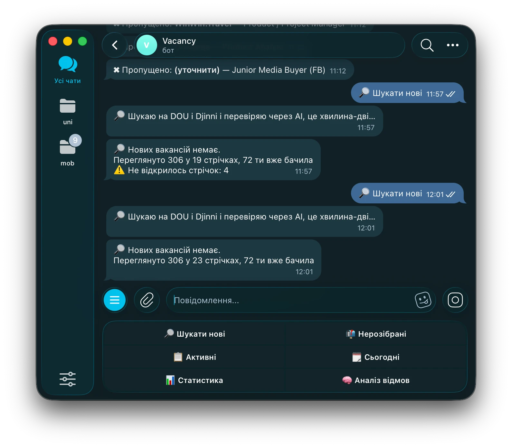
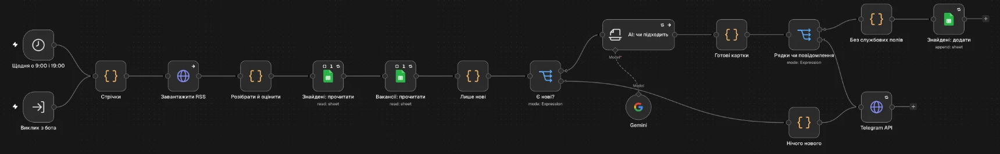
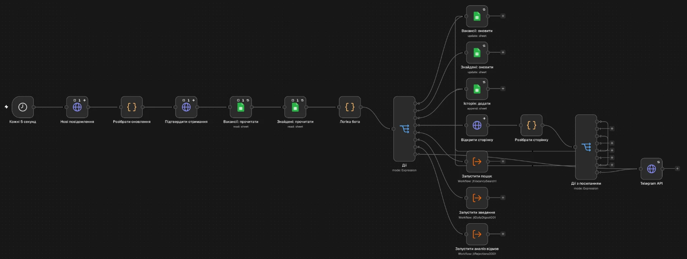
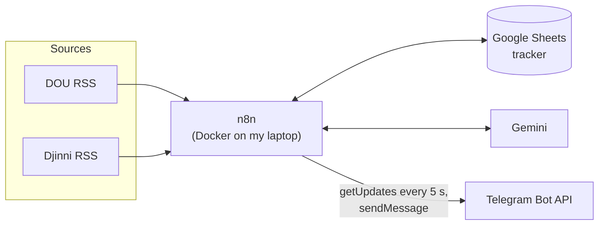

# Job Search Automation with n8n

A self-hosted automation that runs my job search: it finds entry-level vacancies on DOU and Djinni, lets an LLM filter them against my profile, sends the good ones to Telegram with one-tap buttons, keeps a Google Sheet tracker up to date and uses AI to read rejection letters and point out what to improve.

Built with **n8n**, **Google Sheets API**, **Telegram Bot API** and **Google Gemini**, running in **Docker**.

<p align="center">
  
  
  
</p>
<p align="center"><sub>Vacancy cards with one-tap buttons · changing a stage · an on-demand search run</sub></p>

## What it does

| Workflow | Trigger | What happens |
|---|---|---|
| **1 · Vacancy search** | 09:00, 19:00, or `/new` in Telegram | Reads 23 RSS feeds (DOU + Djinni), parses and scores every vacancy with keyword rules, drops the ones already seen, asks Gemini whether each remaining one fits my profile and has no "1+ year" requirement, saves all results to the sheet and sends the matches to Telegram as cards with **Add / Skip** buttons. |
| **2 · Telegram bot** | polls Telegram every 5 s | Commands and buttons: change an application's stage, record a rejection reason, add a vacancy from the inbox, add any vacancy by pasting its link (the page is parsed automatically), stats, on-demand search and analysis. |
| **3 · Morning digest** | 09:05 | Overdue next steps, steps due today or tomorrow, applications with no movement for a week; applications unanswered for 21 days are moved to "no answer" automatically. |
| **4 · AI rejection analysis** | 20:00 daily, Mondays 10:00, or `/insights` | Reads rejection letters pasted into the sheet, extracts the real reason, concrete gaps, advice and a follow-up step, writes them back to the sheet; weekly it summarises patterns across all rejections. |
| **0 · Error alerts** | any workflow fails | Sends the workflow, node and error to Telegram with a link to the execution. |

## Architecture

The vacancy search workflow in n8n: RSS feeds → keyword scoring → de-duplication against the sheet → Gemini check → sheet + Telegram.



The Telegram bot workflow: poll updates → read both sheets → one Code node returns a list of effects → a Switch sends each effect to the node that performs it.





All connections are outgoing: nothing on the internet needs to reach the laptop.

**Two-stage filtering.** Cheap keyword scoring runs first (title matches weigh double, penalties for senior / development / support roles, hard drop for "1+ year" requirements), and only vacancies above the threshold go to the LLM. Every vacancy the AI has seen is stored, so it is never checked twice, and a single run is capped at 20 AI checks to stay inside the free Gemini tier.

**Structured AI output.** Both AI steps use n8n's Information Extractor with a JSON schema, so the model returns typed fields (`fit`, `requires_experience`, `reason_category`, `gaps[]` …), not free text. If the AI call fails, the workflow falls back to the keyword verdict instead of stopping.

**Declarative bot logic.** The bot workflow reads both sheets once, then a single Code node turns the Telegram update into a list of *effects* (`updMain`, `updInbox`, `hist`, `tg`, `runSearch` …). A Switch routes each effect to the node that performs it. Sheet writes always run before the Telegram reply.

**Polling instead of a webhook.** The first version used n8n's Telegram Trigger behind a Cloudflare quick tunnel with a Caddy gate. On a laptop that sleeps every night this broke: Cloudflare deleted the idle quick tunnel ("Tunnel not found"), and Docker lost DNS after wake-up, so the bot went silent. The bot now polls `getUpdates` every 5 seconds and confirms each batch immediately, so overlapping runs never process an update twice. No public URL, no open ports, and it simply resumes after sleep. Successful polls are not stored in the execution history; failures are.

**Resilience.** Retries on Sheets, HTTP and AI nodes (Telegram calls retry for ~25 s to ride out the network coming back after sleep), public DNS for the container, a global error workflow, schedule triggers with "coalesce" misfire policy (if the laptop was asleep at 9:00 the run happens when it wakes up), stale Telegram buttons are detected by a row hash instead of updating the wrong row.

## Results

Real use on my own job search. The tracker runs since 8 Oct 2026, the auto-search since 4 Nov, the AI check since 24 Nov (numbers as of 27 Nov 2026).

| | |
|---|---|
| Vacancies found by the search (passed keyword scoring) | 210 (110 Djinni, 100 DOU) |
| …reviewed with one tap in Telegram | 198: 31 added, 160 skipped, 7 rejected by AI; 12 waiting |
| Checked by AI (since 24 Nov) | 24: 7 rejected for an experience requirement or a profile mismatch |
| Applications sent | 10 |
| Got an answer | 8 of 10 |
| Reached an interview or a test task | 6 |
| Median time to an answer | 11 days |
| Rejection letters analysed by AI | 4 |

**What the numbers say.** The keyword filter is deliberately broad: I skipped 160 of the 198 vacancies it surfaced. So I measured the filter instead of guessing.

### Filter evaluation

My own decisions are the ground truth: 191 vacancies the search surfaced, 31 of which I added and 160 skipped. [`scripts/eval-filter.js`](scripts/eval-filter.js) downloads each vacancy page and runs the same Gemini check as the workflow (same prompt, schema, profile and model), then compares the variants:

| Filter | Cards shown | Of them I added (precision) | My additions it kept (recall) |
|---|---|---|---|
| Keywords only (current threshold 15) | 191 | 31 (16%) | 31 of 31 (100%) |
| Keywords, score ≥ 20 | 58 | 25 (43%) | 25 of 31 (81%) |
| Keywords + AI check | 82 | 20 (24%) | 20 of 31 (65%) |

The AI check in its current form is worse than simply raising the keyword threshold: it shows more cards and loses more of the vacancies I wanted. Reading the 11 it would have dropped, the reason is the profile, not the model: it says "not interested in design / development" and "on-site in Lviv", and Gemini applies that strictly, while in practice I did add a trainee designer, a junior data engineer and a few Kyiv-office roles. So the next steps are to raise `MIN_SCORE` to 20, rewrite the profile as preferences instead of hard rules, and re-run `npm run eval` to compare.

## Engineering

- Search settings live in [`config/profile.json`](config/profile.json); the build injects them into the Code nodes that need them.
- Workflow logic lives in plain JavaScript files in [`src/code`](src/code), shared helpers in [`src/lib/common.js`](src/lib/common.js). [`scripts/build.js`](scripts/build.js) generates the n8n workflow JSON from them, so logic is reviewable and diffable instead of hidden inside the n8n editor.
- **Unit tests** ([`tests/`](tests)) run every Code node with mocked n8n globals on data shaped like real sheet reads and RSS feeds (company names in the test data are fictional): `npm test`. The experience filter is tested on Ukrainian, Russian and English phrasing, including false positives such as salaries and company age.
- During development the generated workflows were also executed in a real n8n 2.48 engine with external services stubbed, and every node's parameters were checked with n8n's own validation helpers.
- Credentials are created from `.env` and a service-account key by [`setup/make-credentials.js`](setup/make-credentials.js); no secrets in the workflows or the repo.
- CI (GitHub Actions) runs the tests and checks that the committed workflows match the sources.

```
config/profile.json      who the search is for: profile, search terms, keyword weights
src/lib/common.js        shared helpers (sheet columns, dates, Telegram calls)
src/code/search/*.js     feed list, RSS parsing + scoring, de-duplication, cards
src/code/bot/*.js        Telegram bot logic, vacancy page parser
src/code/digest/*.js     morning digest
src/code/rejections/*.js AI rejection analysis and weekly insights
scripts/build.js         builds workflows/*.json
scripts/eval-filter.js   measures the filter against my own add / skip decisions
workflows/               ready-to-import n8n workflows
setup/                   creates n8n credentials from .env
tests/                   unit tests
```

## Run it

Requirements: Docker Desktop, a Telegram bot token, a Google Cloud service account with access to the sheet, a free Gemini API key.

```bash
cp .env.example .env            # fill it in
# put the service account key into setup/google-service-account.json
./setup.sh                      # Windows: .\setup.ps1
```

Then open http://localhost:5678, create the n8n owner account and write `/start` to the bot. A step-by-step guide in Ukrainian is in [docs/SETUP.uk.md](docs/SETUP.uk.md).

## Make it yours

Everything personal about the search lives in [`config/profile.json`](config/profile.json): the candidate profile the AI matches against, DOU search terms and Djinni categories, and the keyword weights for scoring. Patterns are case-insensitive regular expressions. After editing it, run `npm run build` and `./setup.sh`.

To change the logic: edit `src/`, run `npm test && npm run build`, then `./setup.sh` again to re-import.

## Background

I started tracking applications in a Google Sheet with an Apps Script automation and a Telegram bot. Apps Script answers webhooks with a redirect that Telegram treats as an error, and its quotas allowed polling only once a minute. Moving to n8n on my own machine removed the quota problem (polling every 5 seconds costs nothing), added AI nodes, proper error handling and testable code, and made the whole thing easy to show and extend.

Built with Claude as a coding assistant. I defined what the system should do and made the product decisions (approve vacancies in Telegram instead of auto-adding, schedules, score thresholds, self-hosting), then tested it on my own job search data and worked through the bugs.
